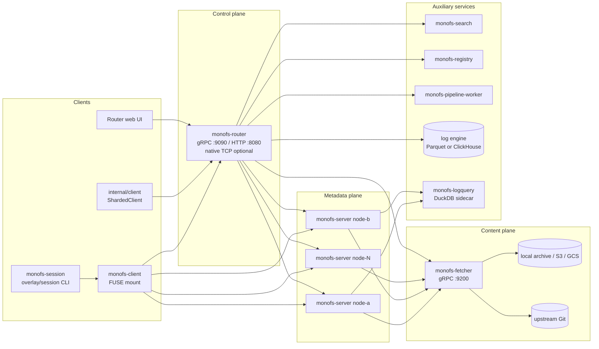

# MonoFS Documentation

This documentation is derived from the source tree and is updated with the code.
When a document disagrees with the implementation, fix the document.

## Read this first

| Document | Audience | What it answers |
|---|---|---|
| [architecture.md](architecture.md) | Engineers, operators, reviewers | What the system is made of, how processes fit together, what the data model is, how it is deployed, and where the boundaries are. |
| [logical-flows.md](logical-flows.md) | Engineers, SRE, security reviewers | What happens end-to-end for ingestion, reads, writes, publish/push, search, registry, pipelines, telemetry, and authentication. |
| [security-architecture.md](security-architecture.md) | Security, platform, reviewers | Assets, threat model, trust boundaries, current controls, and the optional telemetry-encryption model. |
| [duckdb-logquery.md](duckdb-logquery.md) | Operators, query authors | The DuckDB query sidecar, its SQL views, limits, and ClickHouse parity. |

## One-page architecture

MonoFS separates three things that are often one filesystem:

1. **Metadata and namespace** live on `monofs-server` nodes in Pebble. Nodes are stateless with respect to inode numbers: inodes are hashes of paths. Files are placed by weighted rendezvous hashing (HRW).
2. **File content** lives in `monofs-fetcher` as content-addressed, encrypted packager archives, backed by local disk, S3, or GCS. The fetcher can also read Git objects directly and act as the Git sync worker.
3. **Orchestration** lives in `monofs-router`: topology, ingestion, workspace publish/push/refresh, Guardian control paths, Doctor query fan-out, pipeline orchestration, registry/UI proxying, and access-policy distribution.

Telemetry is a separate storage plane. `monofs-server` keeps logs, metrics, and traces in local Parquet chunks by default, or routes all three signals to shared ClickHouse tables with `--spanengine=clickhouse`. An optional `monofs-logquery` DuckDB sidecar serves SQL queries against either engine.

The writable client path is **not** a server-side POSIX write implementation. `monofs-client` writes into a local overlay (NutsDB plus ordinary files), records local virtual commits, and `monofs-session` publishes or pushes the result through the router and fetcher to a Git remote. The server's `Create`/`Write` RPCs exist but are not implemented; the active write model is overlay + bundle sync.

## Source-of-truth notes

- Line references are from the analyzed working tree and are navigation aids, not stable API contracts.
- The codebase mixes go-git v5 and v6, NutsDB and Pebble, and several independent "cache" concepts. The documents name each one explicitly where confusion is possible.
- Components named in comments or old docs may not be wired. Verify in code before relying on a configuration knob.
