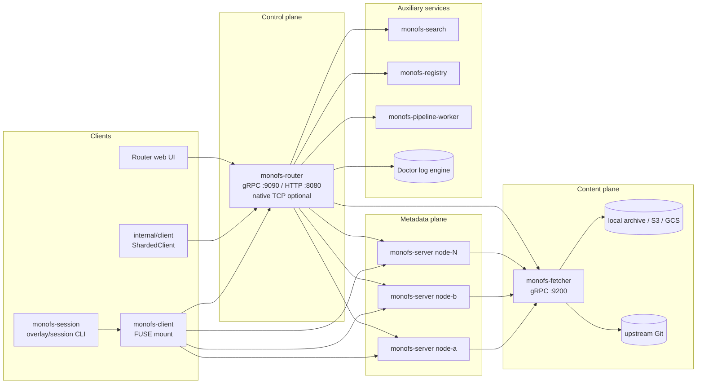

# MonoFS Documentation

This is a new, code-derived documentation set. The previous documentation trees (`docs/`, `documentation/`, `design/`, `research/`, the root `README.md`, `plan_to_do.txt`, and the `k8s/` notes) were moved to `docs_backup/` before this analysis and were not used as input.

The architecture and security documents describe the baseline at commit `f5c527c`, based on reading every tracked code file, protobuf definition, script, Dockerfile, Compose file, workflow, and build manifest. Remediation changes already applied in the working tree are tracked in [internal/remediation-decisions.md](internal/remediation-decisions.md).

## Read this first

| Document | Audience | What it answers |
|---|---|---|
| [architecture.md](architecture.md) | Engineers, operators, reviewers | What the system is made of, how processes fit together, what the data model is, how it is deployed, and where the boundaries are. |
| [logical-flows.md](logical-flows.md) | Engineers, SRE, security reviewers | What happens end-to-end for ingestion, reads, writes, publish/push, search, registry, pipelines, telemetry, and authentication. |
| [security-architecture.md](security-architecture.md) | Security, platform, reviewers | Assets, threat model, trust boundaries, current controls, concrete gaps, and a prioritized remediation plan. |
| [internal/README.md](internal/README.md) | Maintainers and planners | Index of the internal assessment, including the remediation decisions and their status. |
| [internal/code-inventory.md](internal/code-inventory.md) | Anyone navigating the code | Every tracked code file with a code-derived purpose and key symbols. |

## One-page architecture

MonoFS separates three things that are often one filesystem:

1. **Metadata and namespace** live on `monofs-server` nodes in Pebble. Nodes are stateless with respect to inode numbers: inodes are hashes of paths. Files are placed by weighted rendezvous hashing (HRW).
2. **File content** lives in `monofs-fetcher` as content-addressed, encrypted packager archives, backed by local disk, S3, or GCS. The fetcher can also read Git objects directly and act as the Git sync worker.
3. **Orchestration** lives in `monofs-router`: topology, ingestion, workspace publish/push/refresh, Guardian control paths, Doctor query fan-out, pipeline orchestration, registry/UI proxying, and access-policy distribution.

The writable client path is **not** a server-side POSIX write implementation. `monofs-client` writes into a local overlay (NutsDB plus ordinary files), records local virtual commits, and `monofs-session` publishes or pushes the result through the router and fetcher to a Git remote. The server's `Create`/`Write` RPCs exist but are not implemented; the active write model is overlay + bundle sync.

## Source-of-truth notes

- All line references in these documents are from the analyzed working tree and are intended as navigation aids, not stable API contracts.
- The codebase mixes go-git v5 and v6, NutsDB and Pebble, and several independent "cache" concepts. The documents name each one explicitly where confusion is possible.
- Several components named in comments or old docs are not actually present or not wired. Examples: `guardianctl` is not in this repository; the CFG backend has no production `SetCfgStore` call; `monofs-cache` has no build/deploy target; prefetch predictions are discarded because `PredictedFile.ContentID` is never set.
- The `docs_backup/` tree is intentionally not referenced by the new documents. It is retained only for comparison and history.
