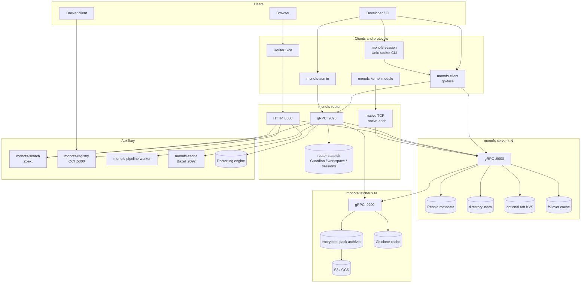

# MonoFS Architecture

**Scope:** code-derived architecture of the MonoFS monorepo. The prior documentation was moved to `docs_backup/` and was not used. References are to source files and symbols; line numbers are navigation aids.

## 1. What MonoFS is

MonoFS is a distributed, content-addressed filesystem and workspace service aimed at large monorepos. It exposes a POSIX-like namespace through a FUSE client (and an optional kernel module), while separating:

- **namespace and metadata** (storage nodes, Pebble),
- **content and upstream fetch** (fetcher tier, encrypted archives plus Git),
- **coordination and write-back** (router, workspace bundles, Git sync),
- **specialized namespaces** for Guardian control data and Doctor telemetry,
- **peripheral services**: code search, OCI registry, CI pipelines, Bazel tooling.

The central design choice is that a file's identity is derived from its user-visible path:

```text
display path          github.com/acme/monorepo
storage ID            SHA-256(display path)                     (hex)
file metadata key     SHA-256(storage ID + ":" + file path)
shard key             storage ID + ":" + file path
blob identity         content hash (usually SHA-256; Git SHA-1 is tolerated in places)
```

The router and sharded client compute the same key from the same path, and HRW maps the key to a weighted, healthy node. A file's primary and replicas are decided by the router during ingestion; reads attempt HRW-ranked nodes, then router fallbacks.

## 2. System context



## 3. Runtime components

| Component | Binary / entry point | Default listeners | Durable state | Primary responsibility |
|---|---|---|---|---|
| Router | `cmd/monofs-router` | gRPC `:9090`, HTTP `:8080`, native TCP optional | Guardian principals/versions, workspace jobs/bundles/WAL, auto-refresh schedule, browser sessions (all local to each router) | Topology, HRW placement, ingestion orchestration, workspace sync, Guardian API, Doctor fan-out, pipeline orchestration, registry/UI proxy, access policy |
| Storage node | `cmd/monofs-server` | gRPC `:9000`, diagnostics `:9100` | Pebble DB (`--db-path`), Git cache, optional KVS data, Doctor log engine, workspace ledger | File metadata, directory index, KVS/CFG content backends, replication metadata, failover cache, predictor, forwarding proxy |
| Fetcher | `cmd/monofs-fetcher` | gRPC `:9200`, diagnostics `:9201` | Local archive cache; optional S3/GCS; Git clone cache; in-memory staged workspace bundles | Content-addressed blob archives, Git blob fetch, workspace publish/push/refresh, upstream log/tags/blame |
| FUSE client | `cmd/monofs-client` | Unix socket under overlay | Overlay session DB, local files, metadata cache, persistent client ID | Mount, read path, overlay writes, local virtual commits, session control |
| Session CLI | `cmd/monofs-session` | none (connects to client socket) | none | `add`, `commit`, `push`, `pull`, `branch`, `diff`, `blobs-info`, etc. |
| Search | `cmd/monofs-search` | gRPC `:9100`, diagnostics `:9101` | Zoekt index and clone cache | Index repositories from MonoFS or Git; query code; symbol extraction |
| Registry | `cmd/monofs-registry` | HTTP `:5000` | MonoFS namespace `docker-registry` | OCI Distribution API; pull-through proxy; manifests/tags/blobs |
| Pipeline worker | `cmd/monofs-pipeline-worker` | optional executor HTTP port | none (task state in Guardian queue) | Execute builder/docker/deployer/bazel jobs; report results |
| Bazel cache | `cmd/monofs-cache` | HTTP `:9092` | local disk (`--dir`) | Bazel AC/CAS remote cache |
| Admin CLI | `cmd/monofs-admin` | none | none | Ingest, delete, status, rebalance, failover, drain, whitelist, index rebuild |
| Bazel CLI | `cmd/monofs-bazelctl` | none | workspace manifest/lock | Generate Bazel workspace, dependency graph, migration states |
| Load test | `cmd/monofs-loadtest` | none | temp files in mount | Filesystem load generation |
| Trace dump | `cmd/monofs-trace-dump` | none | none | Query Doctor traces from router or server |
| Log compactor | `cmd/monofs-logengine-compact` | none | Doctor log directory | Offline compaction |
| FUSE device plugin | `cmd/k8s-fuse-device-plugin` | kubelet device plugin socket | none | Advertise `/dev/fuse` as a Kubernetes resource |
| Kernel module | `monofs-kmod/` | none | none | Out-of-tree filesystem client speaking the native protocol |
| Native build tool | `tools/monofs-native-build` | none | output marker | Bazel genrule fallback for non-migrated repos |

### 3.1 API surface

`api/proto/` defines five gRPC services and 117 RPCs:

| Service | RPCs | Purpose |
|---|---:|---|
| `monofs.MonoFSRouter` | 53 | Topology, ingestion, Guardian, Doctor, whitelist, workspace sync, ledger, upstream reads |
| `monofs.MonoFS` | 37 | Filesystem metadata/data, auth, ingestion, failover, indexing, Doctor, ledger |
| `monofs.BlobFetcher` | 9 | Blob/archive fetch, prefetch, cache check, store, delete |
| `monofs.RepoSyncWorker` | 10 | Workspace bundle staging, publish/push, refresh probe, upstream reads |
| `monofs.MonoFSSearch` | 8 | Index, search, status, rebuild, delete, stats |

The protobuf contract is broad but weakly typed at the telemetry boundary: Doctor query results are opaque JSON (`results_json`, `item_json`, `items_json`), and `QueryResultItem` has two mutually exclusive representations. Authentication is **not** part of the contract; it is carried out-of-band through `authorization: Bearer`, `x-monofs-internal`, and Guardian tokens inside message fields.

## 4. Control plane: `monofs-router`

### 4.1 Startup

`cmd/monofs-router/main.go` registers Git/file ingestion backends in a process-global registry, initializes telemetry, parses roughly 70 flags, constructs `router.NewRouter`, optionally enables the ownership gate, configures search/fetcher/registry/peer credentials, registers static nodes, starts health checks and the access-policy loader, builds auth verifiers, and serves three listeners.

`router.NewRouter` does substantial work before serving:

- opens the Guardian principal and version stores;
- optionally opens the workspace job store;
- loads workspace policy;
- builds the partition grant evaluator;
- starts auto-push and one or more auto-refresh workers;
- initializes the pipeline principal, config watcher, and result watcher;
- starts the UI request goroutine and stale-client cleanup.

### 4.2 Listeners and middleware

| Listener | Server | Authentication |
|---|---|---|
| gRPC `:9090` | `grpc.NewServer`, 1 GiB max messages, telemetry stats, keepalive enforcement | Identity interceptor in **observe mode** (`RequireToken=false`): missing/invalid tokens become anonymous. Per-method authorization only where explicitly coded. |
| HTTP `:8080` | `net/http`, no read/write/idle timeouts | Browser OIDC session or bearer middleware; public health/metrics/static paths; `/api/` requires a non-anonymous identity. |
| Native TCP `--native-addr` | `router.NativeGateway` | Shared token in `MountRequest.AuthToken` (defaults to `MONOFS_TOKEN`); startup fails if native is enabled without one. |

The HTTP chain in browser-OIDC mode is:

```text
otelhttp -> WebAuthenticator -> publicExempt -> apiIdentityCheck -> Router.ServeHTTP -> inner mux
```

In token-only mode it is:

```text
otelhttp -> publicExempt -> Authenticator.HTTPMiddleware -> Router.ServeHTTP -> inner mux
```

`Router.ServeHTTP` also supports a `/monofs/` prefix strip for sub-path deployments.

### 4.3 Routing and topology

- Nodes are `nodeState` values containing `pb.NodeInfo`, a gRPC client, status, health timestamps, and failover bookkeeping.
- Static nodes are marked active without dialing by `RegisterNodeStatic`; dynamic registration dials and probes `GetNodeInfo`.
- `StartHealthCheck` periodically dials/probes nodes, updates versions, handles recovery, and triggers repository discovery.
- `GetClusterInfo` returns the node list, weights, external addresses, cluster version, and feature flags. The same list feeds the client's HRW ring.
- `GetNodeForFile` returns a primary and fallback nodes for a file, derived from repository placement metadata.

The router has one global `sync.RWMutex` for nodes/repos/config and many narrower locks for caches and stores. Several slow operations (node registration, health checks) hold locks across network calls, and the UI snapshot path is serialized through a single goroutine.

### 4.4 Ingestion orchestration

`Router.IngestRepository` is the production write path. It validates the source and authorization, selects an ingestion backend, registers the repository on all healthy nodes, walks files, builds encrypted archives, sends them to a fetcher, shards file metadata by `storageID:path`, sends primary and replica batches, marks onboarding, updates in-memory state, and triggers rebalance/search reindex.

Subsystems and files:

| Concern | Files |
|---|---|
| Validation/normalization | `ingest.go` (`normalizeRepoID`, `goModuleVersion`, `validateGitRef`, `reservedManagedDisplayPathConflict`) |
| Authorization | `authz_ingest.go` |
| Guardian ingestion | `ingest.go`, `guardian_inject.go`, `guardian_path_mapper.go` |
| Ingestion backends | `internal/storage/git`, `internal/storage/file` |
| Archive building | `ingest.go`, `internal/storage/blob` (fetcher side) |
| Replica/batch fan-out | `ingest.go`, `internal/client` |

The detailed step sequence is in [logical-flows.md](logical-flows.md#3-ingestion).

### 4.5 Workspace write-back

The router owns the state machine for publish, source push, and refresh:

- `UploadWorkspaceBundle` / `UploadWorkspaceCommitBundle` buffer client-streamed bundles and validate them with `internal/workspacebundle`.
- `PublishWorkspace` stages the bundle on a fetcher and asks it to apply operations to the upstream branch.
- `PushWorkspaceCommits` applies local virtual commits, either squashed or preserved, with rollback on hard failure.
- `RefreshWorkspace` asks the fetcher to probe upstream heads and re-ingests repositories whose head advanced.
- `autopush.go` retries queued source-push jobs; `autorefresh.go` polls upstream refs and re-ingests.

Jobs live in `r.workspaceSyncJobs` and, when configured, in `internal/storage/workspacestore` (WAL + snapshots). The router currently **writes** jobs/bundles to that store but never rehydrates them after restart.

### 4.6 Guardian control namespace

Guardian is not a separate binary in this repository. It is a set of logical paths managed through the router:

```text
/partitions/<partition>/...       partition assets
/.queues/<principal>/...          pipeline/worker task queues
/.scans/<pusher>/...              scan requests/results
/.pipelines/...                   pipeline configs
/.registry/...                    registry/probe metadata
/doctor/...                       Doctor telemetry namespace
/guardian-system/...              system-managed data
```

The router maps logical Guardian paths to physical repository paths (`guardian/<partition>`, `doctor/...`, `guardian-system`), authenticates Guardian principals by token, authorizes mutations by role, writes inline files to KVS or storage nodes, and maintains a version store and change subscriptions.

Guardian principals are persisted in `guardian_principals.json` (tokens hashed with unsalted SHA-256) and can be seeded from `MONOFS_TOKEN`. Roles are `control-plane`, `cli`, `pipeline`, `pusher`, and `doctor`; role inference defaults unknown IDs to `control-plane`.

### 4.7 Doctor telemetry

Doctor is the observability namespace:

- Services export OTLP traces/metrics/logs (or direct ingest) to storage nodes or the router.
- Storage nodes use `internal/storage/logengine` to write Parquet chunks, manifests, text indexes, and series indexes.
- The router fans out `QueryLogs`, `QueryMetrics`, `QueryTraces`, `StreamQuery*`, and `StreamMetricSeries` to nodes, merges results, and proxies ingest.
- `internal/storage/logquery` parses a log query language.
- `monofs-logengine-compact` compacts ranges offline.

### 4.8 Pipeline orchestration

The router hosts a small CI system:

- Configs are YAML in `/.pipelines/` (or local files) and are parsed by `internal/router/pipeline`.
- Webhooks (GitHub/GitLab) and manual runs create `PipelineRun` values in memory.
- Jobs are expanded (including matrices), written as tasks to `/.queues/pipeline/<run>/tasks/`, and claimed by `monofs-pipeline-worker` through Guardian change subscriptions.
- Results are written to `.results/`, watched by the router, and advance the DAG.
- Commit statuses are reported back to GitHub/GitLab.

The pipeline store is split: configs/tasks/results are persistent Guardian paths, runs/job state/stats are in-memory.

### 4.9 Web UI

`internal/router/ui` is a Vue 3 + Vite + Tailwind SPA embedded into the router binary. It covers dashboard, repositories, ingest, search, fetchers, registry, pipelines, CI/CD, Bazel adoption, cluster, replication, performance, clients, dependencies, and indexer views. The UI calls the router's HTTP API directly with `fetch`; no generated API client is used.

## 5. Metadata plane: `monofs-server`

### 5.1 Storage engine and buckets

Each node stores metadata in Pebble through `internal/metastore`. Buckets are key prefixes:

| Bucket | Key | Value |
|---|---|---|
| `metadata` | `sha256(storageID:filePath)` | JSON `storedMetadata` (path, mode, size, mtime, blob hash, repo info) |
| `repos` | `storageID` | JSON `repoInfo` |
| `pathindex` | `storageID:filePath` | metadata hash key (redundant with deterministic hash) |
| `repolookup` | `displayPath` | `storageID` |
| `dirmeta` | `storageID:dirPath` | canonical directory metadata |
| `direntry` | `sha256(storageID\0dirPath)\0name` | binary directory entry |
| `ownedfiles` | `storageID:filePath` | `"1"` |
| `replicafiles` | `storageID:filePath:primary:nodeID` | replica metadata |
| `onboarding_status` | `storageID` | `"true"`/`"false"` |
| `nodecounters` | `"usage"` | `{total_files, owned_bytes}` |
| `failover` | `failedNodeID:storageID:filePath` | JSON metadata |

### 5.2 Inodes and path model

There is no persistent inode allocation table. Inodes are FNV-1a-64 hashes of paths:

- root = 1;
- repo/intermediate dir = `hashPath(fullPath)`;
- file = `hashPath(fullPath)`;
- canonical/virtual subdirectories = `hashPath(storageID + ":" + dirPath)`.

Attributes are synthetic: uid/gid 1000, `Nlink` 1 for files and 2 for dirs, ctime = atime = mtime, and synthetic directory mtimes are `time.Now()` on each call. The inconsistent hash inputs mean the same directory can have different inode numbers when observed through `ReadDir` and `Lookup`/`GetAttr`.

### 5.3 Directory index

The index has two tiers:

1. **Canonical directory metadata** (`dirmeta`) marks real directories and supports `Lookup`/`GetAttr`.
2. **Per-entry index** (`direntry`) stores one record per child, keyed by a name-ordered prefix, so `ReadDir` can stream and paginate without materializing the directory.

Both are maintained incrementally during ingest. `BuildDirectoryIndexes` is a repair tool, but it only scans `ownedfiles`; it does not rebuild canonical metadata or remove stale entries.

### 5.4 Storage backends

| Backend | Selection | Content location | Notes |
|---|---|---|---|
| Blob (default) | empty/unknown `storage_backend` | Fetcher archives | Blob hash resolved by fetcher; inline content is forwarded to fetcher for batch ingest |
| KVS | `storage_backend="kvs"` | Embedded KVS (local or raft) | Used by the `guardian-system` namespace; replicated by raft when enabled |
| CFG | `storage_backend="cfg"` | CFG version store | Interface and read/ingest code exist, but `SetCfgStore` has no production call site |

### 5.5 Replication, failover, and forwarding

- **Replication**: router sends `IngestReplicaBatch` to replica nodes. Replica metadata is stored in both `metadata` and `replicafiles`; replicas do not get directory-index entries or counters.
- **Failover**: when a node fails, the router calls `SyncMetadataFromNode` with the failed node's file list; the backup copies matching replica metadata into the `failover` bucket. Reads consult that cache on a local metadata miss.
- **Forwarding**: when `--router` is set, a node polls cluster topology, builds an HRW ring, and forwards read RPCs to the owner with `x-monofs-forwarded` as a loop marker.

### 5.6 Predictor and prefetch

`internal/server/predictor.go` maintains per-repo Markov chains, per-client sessions, directory-access counts, and heuristics. The predictor records successful reads asynchronously and can request prefetch. In practice prefetch is dead because `PredictedFile.ContentID` is never populated, so every prefetch is skipped.

### 5.7 Doctor and ledger

The node's Doctor backend wraps `internal/storage/logengine`, configured with a local mock object store (`NewMockS3Store`) even though the type is named S3. The node also exposes a workspace ledger (`AppendLedgerEntries`, `QueryLedger`) backed by an in-memory slice and a WAL in `workspacestore`.

## 6. Content plane: `monofs-fetcher`

### 6.1 Services

`monofs-fetcher` registers both `BlobFetcher` and `RepoSyncWorker` on one gRPC server. It is described in comments as stateless, but it is stateful:

- blob archives live on local disk (and optionally S3/GCS);
- Git clones are cached per process;
- staged workspace/commit bundles live in an in-memory map with a 30-minute TTL.

### 6.2 Blob backend

`internal/storage/blob/backend.go` implements a content-addressed store on top of `github.com/radryc/packager`:

```text
<CacheDir>/archives/<storageID>/chunk-0000.pack
<CacheDir>/archives/_loose/<blobHash>.pack
<CacheDir>/archives/_batch/batch-<unixNano>-0000.pack
```

Archives are encrypted with a 32-byte key (ChaCha20-Poly1305 in the packager pipeline) and compressed. A process-local `blobIndex` maps content hash to archive path and entry path. It is rebuilt by scanning local `.pack` files at startup; cloud-only archives with no local index entry are not discoverable.

Cloud replication is asynchronous. The backup scanner only checks that an object exists via HEAD; it does not compare size or checksum.

### 6.3 Git backend

Two independent Git stacks exist:

- **go-git v5** in `internal/storage/git` for blob fetching (`GitBackend`) and the alternate `GitFetchBackend`.
- **go-git v6** in `internal/git` for workspace sync, upstream reads, clone/fetch, refs, and blob cache.

`internal/gittoken` does not mint tokens. It looks up opaque PATs from `MONOFS_GIT_TOKEN*`, `MONOFS_GITHUB_TOKEN*`, and `MONOFS_GITLAB_TOKEN*`, derives a slug from owner/repo (ignoring the host), and returns HTTP BasicAuth for HTTPS URLs.

### 6.4 Workspace sync worker

The fetcher applies workspace bundles to temporary Git worktrees:

- clone/open the upstream repo;
- verify base commit if provided;
- checkout/create target branch;
- apply `upsert`, `delete`, `mkdir`, `rmdir`, `symlink`, `rename`, `chmod`;
- stage, commit with an explicitly unsigned signer;
- push with `AuthForRepo`;
- report per-repository `RepoSyncProgress`.

Publish filters sensitive paths; source push does not apply the same filter. Source push supports squash and preserve modes, with best-effort revert commits for rollback.

### 6.5 Upstream reads

`GetUpstreamLog`, `GetUpstreamTags`, and `GetUpstreamBlame` clone full history into a cache and return results. Log is capped at 200 entries; blame caps files at 1 MiB.

## 7. Client plane

### 7.1 FUSE client

`internal/fuse` is a library of go-fuse node implementations plus overlay/session/VCS machinery; the mount lifecycle is in `cmd/monofs-client`.

Key models:

- `MonoNode` is the inode; it holds a path, cached full content, mode/size, client, cache, session manager, workspace projection, and visible owner.
- `SessionManager` owns one current write session, stored under `<overlay>/sessions/<id>/` with `overlay.db` (NutsDB) and ordinary files.
- `OverlayManager` merges backend listings with overlay files, tombstones, and user root dirs.
- `CommitManager` builds local virtual commits and pushes `workspacebundle.SourceCommitBundle`.
- `SessionSocketHandler` is the JSON-over-Unix-socket control plane used by `monofs-session`.
- `WorkspaceManifest`, `RepoFilter`, and `WorkspaceGitProjection` implement the virtual monorepo and a synthetic Git repository.

### 7.2 Read path

The normal read path is:

```text
Lookup -> overlay state -> metadata cache -> ShardedClient.Lookup (2 retries)
Open   -> overlay file or ShardedClient.Read(path, 0, 0)  (whole file)
Read   -> slice of cached content
```

Backend files are always materialized in full at open, regardless of requested read size. `n.content` has no TTL, size cap, or eviction beyond inode GC.

### 7.3 Write path

Writable mounts create a session automatically. Writes go to ordinary files under the session directory; `Flush` records a `ChangeModify`/`ChangeCreate` in NutsDB. NutsDB is opened with `SyncEnable=false`. A crash between `write(2)` and `close(2)` leaves a file on disk with no DB entry, and `RebuildFromDisk` only runs when the DB is completely empty.

`monofs-session add/commit/push` stages content snapshots, builds local virtual commits grouped by repository, advances committed entries to a hidden `ChangeBaseline` state, and pushes via the router/fetcher.

### 7.4 Native client

`monofs-kmod` is an out-of-tree filesystem that speaks a custom framed TCP protocol to the router's optional native gateway. The gateway reuses the router namespace APIs (`NativeLookup`, `NativeGetAttr`, `NativeReadDir`, `NativeRead`, `NativeStatFS`) and object IDs are the first 16 bytes of `SHA-256("monofs-native-path:" + path)`. The mount requires the shared gateway token (`--native-auth-token`, default `MONOFS_TOKEN`) when the listener is enabled; the kmod sends it as `auth_token=`.

## 8. Auxiliary planes

### 8.1 Search (`monofs-search`)

- Index jobs are queued in memory and persisted as job/repo metadata.
- Indexing reads a repository through the sharded client (or clones it when no router client is configured), filters binary and oversized files, and feeds documents to a Zoekt builder.
- Search supports Zoekt query syntax, substring queries, file patterns, and symbol extraction.
- Read-policy filtering is applied **after** search; the service's authenticator is constructed with `requireToken=false`.

### 8.2 Registry (`monofs-registry`)

- OCI Distribution HTTP API with manifests, tags, blobs, chunked uploads, pull-through proxy, stats, and repo listing.
- Data is stored in a MonoFS namespace (`docker-registry` by default): `_blobs/sha256/<hex>`, `<repo>/_tags/<tag>`, `_catalog`.
- The HTTP server has no authentication, no TLS, and no timeouts.
- Blobs are global by digest; uploads are in-memory sessions writing temp files; manifests are stored as blobs.

### 8.3 Pipeline worker

- Subscribes to Guardian `/.queues/pipeline` changes, parses task events, claims tasks with `expected_version_id="absent"`, executes one of four handlers, and writes results.
- Handlers: `builder` (shell + builtins), `docker` (shell), `deployer` (shell), `bazel` (shell + BEP parsing).
- Optional executor HTTP API executes arbitrary argv with env/files/outputs. It now requires a bearer/dedicated token and bounds request size; it is still unsandboxed.

### 8.4 Doctor and telemetry

- `internal/telemetry` configures OTLP exporters, trace/metric/log providers, and a `slog` bridge.
- The default endpoint mode is insecure; `https://` schemes are stripped and not re-applied unless `insecure=false`.
- `internal/storage/logengine` stores Parquet chunks plus manifests/indexes; query execution prunes by time, labels, partitions, and manifests.
- `internal/storage/logquery` implements the query language (filters, regex, pipes; unknown pipes are silently ignored).
- `cmd/monofs-logquery` is an optional DuckDB sidecar on each storage node. `monofs-server --logquery-sidecar=...` proxies telemetry read RPCs to it and keeps ingest/compaction local. See `docs/duckdb-logquery.md`.

### 8.5 Bazel

- `internal/bazel` generates `MODULE.bazel`, `WORKSPACE`, `.bazelrc`, `BUILD.bazel`, and `.bazelversion`.
- `deps` discovers go.mod imports, writes a lockfile, builds a dependency resolver, and detects cycles.
- `gazelle` invokes Gazelle or a simple fallback to generate BUILD files.
- `cache` is a standalone Bazel AC/CAS HTTP server (not wired into the Makefile/Docker deployment).
- `migration` tracks fallback genrules and state transitions.

## 9. Data model and addressing

### 9.1 Paths and identifiers

| Concept | Definition | Code |
|---|---|---|
| Display path | User-visible repository path, e.g. `github.com/acme/repo` | `normalizeRepoID`, `monopath.SplitDisplayPath` |
| Storage ID | `hex(SHA-256(displayPath))` | `sharding.GenerateStorageID` |
| File key | `sha256(storageID + ":" + filePath)` | `server.makeStorageKey` |
| Shard key | `storageID:filePath` | `sharding.BuildShardKey` |
| Blob hash | Content hash; Git SHA-1 or SHA-256 depending on source | `FileMetadata.ContentHash`, fetcher |
| Workspace ID | Client-scoped workspace identifier | `workspacebundle`, `ShardedClient` |
| Guardian logical path | `/partitions/...`, `/.queues/...`, etc. | `router.guardian_path_mapper` |

`monopath.SplitDisplayPath` uses namespace-specific component counts:

- `dependency`, `guardian-system`: one component;
- `guardian`, `doctor`: two components;
- everything else: three components.

There is no tenant component, no path cleaning at the authorization boundary, and no case folding.

### 9.2 Repository metadata

A repository is registered by `storageID` and mapped from `displayPath`. It records source URL, branch, commit, file count, fetch type, storage backend, Guardian URL, and onboarding state. Registration is not uniqueness-checked: a later registration can overwrite the display-path mapping and hijack a namespace.

### 9.3 Workspace job model

`WorkspaceSyncJob` has states `QUEUED`, `RUNNING`, `SUCCEEDED`, `FAILED`, `CANCELLED`; each repository result has `UNCHANGED`, `REFRESH_REQUIRED`, `REFRESHED`, `PUBLISHED`, `ROLLED_BACK`, `CONFLICT`, `FAILED`, or `CANCELLED`. Bundles are identified by `wbundle-<UnixNano>` / `wcommit-<UnixNano>` and expire after 30 minutes.

## 10. Deployment topology

The checked-in `docker-compose.yml` describes a 14-service development cluster:

| Service | Image target | Exposure | Notes |
|---|---|---|---|
| `fetcher-a`, `fetcher-b` | main `fetcher` | internal `:9200`/`:9201` | encryption key required; local archive by default |
| `search-index` | main `search` | internal `:9100`/`:9101` | no compose dependency on router |
| `haproxy` | external `../lb` build | host `9090`, `8080` | plain TCP/HTTP; stats not published |
| `router-a`, `router-b` | main `router` | via HAProxy | no state volume; independent local state |
| `node-a` ... `node-e` | main `server` | host `9001`-`9005` directly | `/data` volume; `node-a` bootstraps KVS raft |
| `client`, `client2`, `client3` | main `client` | SSH `2222`-`2224` | privileged, SYS_ADMIN, `/dev/fuse`, known `monofs` password |
| `minio` (S3 overlay) | MinIO | host `19000`/`19001` | default `minioadmin` credentials; bucket made public-read |

The `Dockerfile` is a 19-stage multi-target build for UI, Go builders, and runtime images. `Dockerfile.search` duplicates the search image with a different base and healthcheck. `Dockerfile.pipeline-worker` and `Dockerfile.guardianctl` require an external `guardian` build context that is not in this repository.

Deployment defects identified in the baseline analysis (status and fixes in [internal/remediation-decisions.md](internal/remediation-decisions.md)):

- **[fixed]** Compose used `context: ..` while the Dockerfile expects the repository root.
- **[fixed]** Routers required auth config that Compose did not pass; `MONOFS_TOKEN` is now required.
- **[fixed]** The fetcher entrypoint passed `monofs-fetcher` as a positional argument, so later flags (including `--config`) were ignored.
- **[fixed]** Node ports bypassed the router/HAProxy boundary; host mappings are now loopback-only.
- **[fixed]** CI built the wrong Docker target and did not build most binaries; the matrix now builds server/router/search and `make build` covers all binaries.
- **[fixed]** `go.sum` was deleted on release; the workflow/action are removed. KVS/CFG pins still differ between images.

## 11. Consistency, durability, and failure model

### 11.1 What is strongly consistent

- A single storage node's metadata writes are one Pebble batch under `metastore.Update` (unless `db_sync=false`, the default, which still writes but does not fsync).
- KVS mode delegates consistency to the embedded/raft KVS.
- The workspace WAL replays records in sequence order; a truncated tail is tolerated.

### 11.2 What is eventually consistent or best-effort

- Cross-node placement: no distributed transaction, no lease, no epoch, no anti-entropy.
- Replica ingestion is fire-and-forget; replica failures never fail the request.
- Blob upload is asynchronous for cloud copies; local archives are authoritative.
- Search indexing is asynchronous and has no retry/backpressure.
- Workspace jobs and bundles are not rehydrated after a router restart despite being persisted.
- Guardian version history is in-memory for content; only metadata snapshots are persisted, and machinery paths (dot-prefixed) are never persisted.
- Failover cache TTL is accepted by the metastore API but ignored; deleted files can be resurrected from it.

### 11.3 Read and write guarantees

- A read from any healthy HRW-ranked node can serve a replica; there is no read-your-writes guarantee across nodes.
- The sharded client retries ranked nodes and fallbacks; `ReadDir` queries all healthy nodes and errors rather than returning a partial listing.
- Ingestion is upsert-only: files deleted upstream remain visible until explicitly deleted.
- Partial primary batch failures still end in `COMPLETED`; only a total failure fails the RPC.
- The writable client is not atomic with Git: overlay, local commits, and remote pushes are separate steps with crash windows.

## 12. Configuration and secrets

### 12.1 Main configuration surfaces

| Binary | Main inputs |
|---|---|
| Router | ~70 flags; `MONOFS_TOKEN`, OIDC variables, access-policy URL/file/token, authz grants JSON, encryption key, peer/registry tokens, state dirs |
| Server | node ID, address, DB/Git paths, fetcher addresses, KVS peers/raft, access policy, OIDC, internal token, log engine, router for forwarding |
| Fetcher | JSON config (`/etc/monofs/fetcher.json`), env, flags; encryption key; S3/GCS settings; cache limits |
| Client | router, mount, cache, overlay, writable, virtual monorepo, token, external addresses |
| Search | port, index/cache dirs, router address, token, OIDC, authz enforce, guardian index flag |
| Registry | listen address, router address, token, data namespace, upstream mappings, credentials (parsed but unused) |
| Worker | router, guardian token, worker type, executor port |
| Pipeline | config YAML, package metadata, webhook secrets, forge tokens |

### 12.2 Secret handling

- `MONOFS_TOKEN` is reused as break-glass admin, Guardian control-plane seed, internal node/search bypass token, peer/registry token, ingest token, and default `dogfood` token.
- The fetcher encryption key is a 32-byte process value; it is also accepted from JSON config and CLI flags.
- Git tokens are static environment PATs; there is no token minting, scope, expiry, or revocation.
- Browser sessions store the raw ID token in a cookie; the persistent session store is unused.
- Registry upstream username/password flags exist but are never read.

## 13. Cross-cutting concerns

### 13.1 Observability

- Prometheus metrics are registered in router, server, fetcher, search, registry, pipeline worker, and log engine.
- OTLP traces/metrics/logs use `internal/telemetry`; the default is insecure and the endpoint scheme is stripped.
- Doctor stores logs/metrics/traces in the log engine; the router fans queries out to nodes.
- Diagnostics HTTP servers expose `/metrics` and full pprof without authentication.

### 13.2 Authentication and authorization

The detailed model is in [security-architecture.md](security-architecture.md). In brief:

- HTTP: browser OIDC (Authorization Code + PKCE) or bearer token; session cookie contains the raw ID token.
- gRPC: bearer interceptor, but router and search are in observe mode and server enforcement requires a policy source.
- Guardian: opaque payload/header token mapped to a persisted principal and role.
- Internal: `x-monofs-internal` shared token bypasses node/search read policy.
- Authorization: two policy systems (`authz.GrantStore` and `authz/policy`), plus OWNERS/CODEOWNERS, plus per-handler role checks, plus an in-memory ingestion whitelist.

### 13.3 Error handling

Most handlers return plain `fmt.Errorf` errors, which become gRPC `Unknown`; only a few paths map to `PermissionDenied`, `InvalidArgument`, `NotFound`, or `FailedPrecondition`. Several control-plane RPCs return `Success:false` with a nil error, so clients cannot distinguish partial failure from success.

### 13.4 Extension points

| Extension | Mechanism |
|---|---|
| Ingestion backend | `storage.DefaultRegistry.RegisterIngestionBackend` (Git, file; S3 enum exists but no backend) |
| Fetch backend | `RegisterFetchBackend` exists but no `CreateFetchBackend`; fetcher uses its own registry |
| Storage backend | Per-repository `storage_backend` (`blob`, `kvs`, `cfg`) |
| Auth verifier | `authz.Verifier` chain (OIDC, static/break-glass, noop) |
| Policy | `access.yaml` compiled to a bundle and polled by router/nodes/search |
| Ownership | `OwnershipResolver` with `.guardian/OWNERS` and an optional CODEOWNERS provider |
| Pipeline runner | `builder`, `docker`, `deployer`, `bazel`, `lambda` runner names |
| UI | Vue pages under `internal/router/ui/src/pages`, static embed in router |
| Client | FUSE ops in `internal/fuse`; native protocol in `internal/nativeproto`; kernel module in `monofs-kmod` |
| Search | `internal/search` indexer/handlers; Zoekt builder |
| Telemetry | OTLP exporters in `internal/telemetry`; log engine backend |

## 14. Where to find what

This is a coarse map; the complete file-by-file inventory is in [internal/code-inventory.md](internal/code-inventory.md).

| Area | Key files |
|---|---|
| Router startup/topology | `cmd/monofs-router/main.go`, `internal/router/router.go`, `ui_handler.go`, `stats.go` |
| Router authn/authz | `access_policy.go`, `authz_*.go`, `guardian_principals.go`, `whitelist.go`, `grpc_auth.go` |
| Ingestion | `internal/router/ingest.go`, `internal/storage/git/ingestion.go`, `internal/storage/file/ingestion.go` |
| Workspace write-back | `internal/router/workspace_*.go`, `internal/router/autopush.go`, `internal/router/autorefresh.go`, `internal/fetcher/workspace_*.go` |
| Guardian | `internal/router/guardian_*.go`, `pipeline_kvs.go`, `internal/router/pipeline/` |
| Storage node | `internal/server/fs.go`, `directory.go`, `direntry.go`, `server.go`, `proxy.go`, `failover.go`, `predictor.go` |
| Storage backends | `internal/storage/blob/backend.go`, `internal/storage/workspacestore/`, `internal/metastore/store.go` |
| FUSE | `internal/fuse/*.go` (ops, session, overlay, commit, workspace) |
| Client | `internal/client/sharded.go`, `workspace_*.go`, `internal/fetcher/client.go` |
| Auth library | `pkg/authz/`, `pkg/authz/policy/` |
| Search | `internal/search/` |
| Registry | `internal/registry/` |
| Git | `internal/git/`, `internal/gittoken/`, `internal/storage/git/` |
| Pipeline worker | `internal/worker/`, `internal/worker/executor/` |
| Telemetry | `internal/telemetry/`, `internal/storage/logengine/`, `internal/storage/logquery/` |
| Bazel | `internal/bazel/` |
| Kernel module | `monofs-kmod/` |
