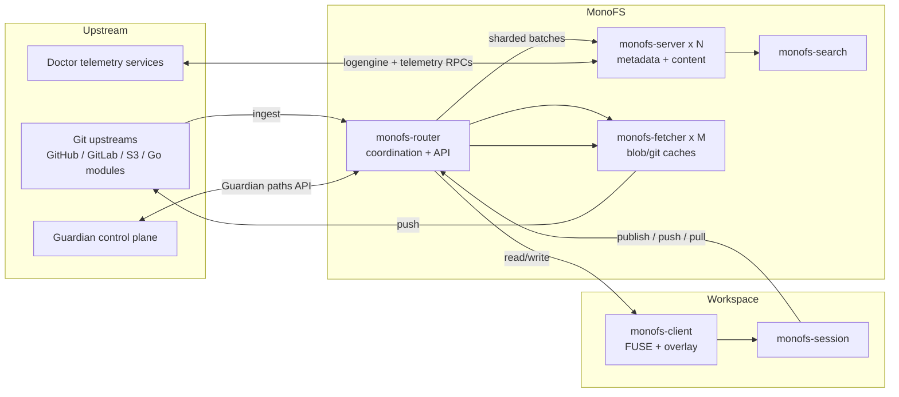

# MonoFS Architecture

> This document describes the current implementation. It was written from the
> source tree and supersedes earlier architecture notes. Where the code and
> older docs disagree, the code wins.

## 1. Overview

MonoFS is a distributed filesystem that projects many independent repositories
and two managed namespaces (Guardian and Doctor) into a single mountable
**virtual monorepo**. It combines:

- **Cluster storage** — repository content is sharded across storage nodes with
  replication and failover.
- **Workspace projection** — a FUSE client presents everything as one writable
  workspace with local overlays, session VCS, and upstream publish flows.
- **Managed namespaces** — Guardian deployment intent and Doctor telemetry are
  first-class subtrees (`guardian/...`, `doctor/...`) served by the same router
  and storage fabric.

The system is a set of Go services plus a FUSE client:

| Component | Binary | Default ports |
| --- | --- | --- |
| Router (coordinator, API, UI) | `monofs-router` | gRPC `:9090`, HTTP `:8080`, native TCP optional |
| Storage node | `monofs-server` | gRPC `:9000` |
| Fetcher (blobs, git, publish) | `monofs-fetcher` | gRPC `:9200`, diagnostics `:9201` |
| Search (Zoekt + ctags) | `monofs-search` | gRPC `:9100`, diagnostics `:9101` |
| FUSE client | `monofs-client` | session unix socket |
| Session CLI | `monofs-session` | talks to the socket |
| Admin CLI | `monofs-admin` | talks to router gRPC/HTTP |
| OCI registry | `monofs-registry` | HTTP `:5000` |
| Bazel remote cache | `monofs-cache` | HTTP `:9092` |
| Pipeline worker | `monofs-pipeline-worker` | executor HTTP |
| Bazel workspace tool | `monofs-bazelctl` | — |
| Load tester | `monofs-loadtest` | — |
| Trace CLI | `monofs-trace-dump` | — |
| FUSE device plugin | `k8s-fuse-device-plugin` | kubelet socket |

## 2. System Context

Everything flows through the router for coordination, but data planes are
direct: clients read/write storage nodes, and telemetry queries hit the
logengine on nodes (routed by the router).

## 3. Domain Model

### 3.1 Repository identities

Every unit of content has three identities (`internal/monopath/path.go`,
`internal/sharding/key.go`):

- **Source** — the upstream location: a Git URL, Go module path, S3 prefix, or
  local path. Validated and normalized at ingest (`internal/router/ingest.go`).
- **Display path** — the user-visible root inside the workspace. Either
  explicitly assigned via `source_id` or derived from the source. Rules:
  - `dependency`, `guardian-system` → 1 path segment (system namespaces)
  - `guardian/<partition>`, `doctor/<version>` → 2 segments (managed namespaces)
  - everything else → first 3 segments of the source path (`host/owner/repo`)
- **Storage ID** — `sha256(displayPath)` hex, a stable internal identifier.

The **shard key** is `storageID + ":" + filePath`, or just `storageID` for the
repository root. Both router and client derive it with the same helpers so
routing decisions match exactly.

### 3.2 Namespaces

- Normal repositories are ingested under their display path.
- `guardian/<partition>` and `guardian-system` are **router-managed**: Guardian
  writes intent/config files through router RPCs, and the router maps logical
  Guardian paths (`/partitions/...`, `/.queues/...`, `/.scans/...`,
  `/.archive/...`, `/.registry/...`, `/.pipelines/...`) to physical display
  paths and storage IDs (`internal/router/guardian_path_mapper.go`).
- `doctor/v1` is a **synthesized namespace**: directory listings are generated
  by the storage node (`internal/server/managed_namespaces.go`), while actual
  telemetry flows through logengine RPCs and query results are materialized
  through the FUSE layer (`internal/fuse/op_read.go`).
- Normal ingestion is blocked from colliding with reserved namespaces
  (`reservedManagedDisplayPathConflict` in `internal/router/ingest.go`).

### 3.3 Sessions and overlays

Writability is client-side. A writable mount keeps an overlay database
(NutsDB) plus session/VCS metadata. Local commits, branches, conflicts, and
staged changes live entirely in the overlay until explicitly pushed.

## 4. Component Inventory

### 4.1 monofs-router (`cmd/monofs-router`)

Cluster brain. Responsibilities:

- Node topology, health, failover, rebalance, drain (`internal/router`).
- Repository ingest orchestration: validation, whitelist, display-path
  derivation, node registration, sharding plan, batch dispatch, replica
  batches, search triggers.
- Client registry and heartbeats; router-to-router peering.
- Guardian mutations (`UpsertGuardianPaths`, `DeleteGuardianPaths`,
  `InjectGuardianPartition`), Guardian version store, change subscriptions,
  Guardian principals/tokens.
- Workspace sync: bundle staging, publish jobs, source push, refresh, ledger.
- Pipelines: discovery of `.monofs/pipelines/*.yml`, DAG orchestration, task
  queue over Guardian KVS, affected-build computation.
- Telemetry fan-out: routes logengine ingest/query to the owning node via HRW.
- HTTP UI/API (`:8080`) and optional native TCP gateway (`--native-addr`).

Persistent state (when configured): Guardian state dir, workspace state dir
(WAL + snapshots), authz grants, search index trigger state.

### 4.2 monofs-server (`cmd/monofs-server`)

Storage node:

- Pebble-backed metastore (`internal/metastore`) with bucket-style key spaces.
- File metadata, path indexes, repository registry, directory indexes
  (per-entry records), owned/replica file lists, onboarding status.
- Lookup/GetAttr/ReadDir/Read, ingest batches, replica batches, deletes.
- Failover cache (files served when the primary owner is down).
- Read prediction/prefetch (`--enable-prediction`).
- Optional embedded KVS (Raft) for `guardian-system` and KVS-backed repos
  (`--kvs-*` flags), and optional Doctor logengine (`--logengine-dir`).

### 4.3 monofs-fetcher (`cmd/monofs-fetcher`)

Data-plane worker for large content:

- Blob backend (always on): archive staging, caching, cloud tier (S3/GCS).
- Git backend (optional): clone/fetch/ref resolution for ingestion.
- Workspace bundle staging, publish execution, source-commit push (squash and
  preserve modes), refresh probing.
- Multi-fetcher client with repository affinity so repeated fetches hit a
  warm cache (`internal/fetcher/client.go`).

### 4.4 monofs-search (`cmd/monofs-search`)

Zoekt-based full-text and symbol search:

- Index/queue/worker service; indexes are triggered by ingest, publish,
  source push, and Guardian partition upserts (debounced).
- Prefers reading files from storage nodes over external cloning.
- `sym:` queries require universal-ctags with `+interactive`.
- Guardian partitions are skipped unless `--index-guardian` is set.

### 4.5 monofs-client (`cmd/monofs-client`)

FUSE client (`internal/fuse`):

- Presents the workspace tree; resolves paths through local HRW sharding.
- Read caches: NutsDB attr/dir cache with short TTLs.
- Writable mode: overlay DB, change tracking, session socket at
  `<overlay>/session.sock`, commit/push/pull/conflict machinery.
- Virtual-monorepo projection and repo filtering (`--include`/`--exclude`).
- Local Git shims for workspace ergonomics (`workspace_git.go`).

### 4.6 Other binaries

- **monofs-session** — JSON actions over the client's unix socket: `status`,
  `diff`, `commit`, `branch`, `log`, `tags`, `blame`, `pull`, `conflicts`,
  `discard`, `push`, `push-blobs`, `push-deps`, `blobs-info`, `search`.
- **monofs-admin** — cluster admin: `ingest`, `status`, `delete`, `failover`,
  `rebuild-index`, `repos`, `rebalance`, `drain/undrain`, `node-files`,
  `fetchers`, `whitelist`, `dogfood`, stats.
- **monofs-registry** — Docker Registry v2 on top of MonoFS KVS, with
  pull-through proxying and chunked blob storage (`internal/registry`).
- **monofs-cache** — Bazel Remote Cache (AC + CAS) over HTTP with age/byte
  eviction (`internal/bazel/cache`).
- **monofs-pipeline-worker** — claims CI tasks from the Guardian KVS queue and
  runs builder/docker/deployer/bazel handlers, optionally exposing an
  REAPI-style executor with CAS (`internal/worker`).
- **monofs-bazelctl** — generates and manages a Bazel workspace over the
  mounted monorepo; dependency graph/affected computation.
- **monofs-loadtest** — FUSE read/write load generator.
- **monofs-trace-dump** — Doctor trace lookup CLI.
- **k8s-fuse-device-plugin** — advertises `sretoolhub.com/fuse` devices so
  pods can request FUSE-capable mounts.

## 5. Internal Architecture

### 5.1 Sharding (HRW)

`internal/sharding` implements Rendezvous (Highest Random Weight) hashing:

- Score = `fnv64a(key || nodeID) * weight`; only healthy nodes are considered.
- `GetNode(key)` picks the primary owner; `GetNodes(key, N)` returns the top N
  for replication/fallback.
- Weight lets operators bias placement; weight 0 is treated as 1.
- The router computes ownership at ingest and on rebalance; clients maintain a
  local HRW from router topology snapshots, so reads do not require a router
  round trip in the steady state.

Topology versions are snapshotted by the router so routing stays consistent
while a rebalance is in flight.

### 5.2 Storage node layout

Metastore: Pebble (`internal/metastore/store.go`) with buckets emulated as key
prefixes. Buckets used by `internal/server`:

| Bucket | Contents |
| --- | --- |
| `metadata` | file hash → stored metadata |
| `repos` | repository records |
| `pathindex` | `storageID:path` → file hash |
| `repolookup` | display-path → storage ID lookups |
| `dirmeta` | directory metadata |
| `direntry` | one record per directory child (per-entry index) |
| `ownedfiles` / `replicafiles` | primary/replica file lists |
| `onboarding_status` | ingest completion markers |
| `nodecounters` | node counters/stats |
| `failover` | TTL'd copies of replica metadata for failover serving |

Directory listings use the per-entry index with prefix-scanned pages rather
than a single per-directory blob, which keeps large directories cheap to update
and stream (`internal/server/direntry.go`, `internal/server/directory.go`).

### 5.3 Client resolution and failover

1. Client registers with the router and receives cluster info (nodes,
   addresses, health).
2. `Lookup`/`ReadDir`/`Read` compute the shard key locally and try the top
   HRW nodes in order.
3. On "not found" the client scans other healthy nodes; on RPC errors it asks
   the router (`GetNodeForFile`), which accounts for failover maps and
   rebalance state.
4. Routing TTLs: stable 300s, failover 30s, rebalancing 10s, dual-active 60s.

Failover: when a node is unhealthy, the router assigns a failover node, pushes
file lists (`syncFailoverCache`), and storage nodes serve those files from the
`failover` bucket. A delayed permanent rebalance runs after `--rebalance-delay`
(10m default) unless the node recovers; rebalance copies only files whose HRW
owner changed and records a move plan for cleanup.

### 5.4 Caching layers

- Client: NutsDB attr/dir cache, ~30s TTL, prefix invalidation.
- Fetcher: archive/blob cache with size and age limits, plus an optional
  S3/GCS cloud tier with key guarding.
- Server: read prediction/prefetch when enabled.
- Search: bounded streaming readers when indexing from storage nodes.

### 5.5 Workspace sync store

Publish/sync jobs are persisted by `internal/storage/workspacestore` (WAL +
snapshots) when `--workspace-state-dir` is set, so router restarts do not lose
in-flight jobs. The router exposes job query/cancel APIs and a ledger of
workspace operations.

### 5.6 Doctor logengine

When `--logengine-dir` is set, storage nodes host the logengine
(`internal/storage/logengine`):

- Ingest writes chunked Parquet files (`data.parquet`) plus a Bluge full-text
  index and a `manifest.json` per signal/chunk; metrics also get a series index
  and traces get bloom filters.
- New chunks are written under hourly time buckets
  (`chunks/<signal>/YYYY/MM/DD/HH/<chunkID>/`). Queries list only buckets that
  overlap their time range, including one bucket of overlap before the start.
  Legacy flat chunks remain readable during migration.
- A background compactor merges complete hourly windows into larger chunks
  (`--logengine-compact-interval`, `--logengine-compact-age`). Compacted chunks
  are grouped by service (logs/traces) or metric name (metrics) when the group
  count is bounded, so service/name filters can prune more chunks. Metric
  compaction uses 15-minute windows, traces 30 minutes, and logs one hour.
- Log manifests carry bounded level/label dictionaries and a trace-ID bloom;
  queries use them for safe positive pruning before opening Parquet or Bluge.
- Query parses the log query syntax and filters by service/time.
- The router fans telemetry ingest/query to nodes via HRW over
  `telemetry:tenant=...:signal=...:chunk=...` keys
  (`internal/router/router.go`), and the server exposes a Doctor backend over
  gRPC (`internal/server/doctor_backend.go`).

## 6. End-to-End Flows

### 6.1 Repository ingest

1. Client calls `IngestRepository` on the router (admin CLI, UI, or auto-refresh).
2. Router checks the whitelist, validates Guardian tokens for managed ingest,
   derives display path + storage ID, and authorizes against partition grants.
3. The storage backend (git/s3/file) is created and validated; commit metadata
   is captured.
4. Repository metadata is registered on **all healthy nodes**; intermediate
   directory caches are invalidated.
5. Files are walked and sharded: `GetNodes(shardKey, replicationFactor)` gives
   the primary plus replicas.
6. Deduplicated blobs are packed and encrypted into archives (ChaCha20-
   Poly1305, split at 2 GiB) and streamed to a fetcher (`StoreArchive`).
7. Primary nodes receive `IngestFileBatch` in 1000-file batches with bounded
   concurrency; replicas receive asynchronous best-effort batches.
8. Directory indexes update incrementally; nodes are marked onboarded.
9. Re-ingest triggers a rebalance of changed ownership, bumps the native
   namespace generation, and triggers search indexing.

### 6.2 Mount and read path

- Client fetches topology → builds HRW → registers as a client.
- `Lookup` resolves root/intermediate dirs, managed namespaces, repo roots,
  KVS/cfg-backed paths, and file metadata (hash key first, canonical dir
  fallback).
- `Read` streams from the owner with failover; when blob content is needed the
  server reads through the fetcher, which routes to the warm fetcher.

### 6.3 Writable session lifecycle

- Writes go to the overlay; change kinds include create/modify/delete/mkdir/
  rmdir/symlink and user-root operations.
- `monofs-session` drives the socket API:
  - `status` / `diff` — inspect staged changes.
  - `commit` — create a local virtual commit and advance the baseline.
  - `branch` — logical branches over the overlay.
  - `push` — group changes per repository, build a source-commit bundle, and
    send it to the router (`PushWorkspaceCommits`) → fetcher
    (`StartWorkspaceCommitPush`).
  - `pull` — refresh repositories from upstream and 3-way merge with git-style
    conflict markers; conflicts surface via `conflicts`.
  - `push-deps` — upload overlay blobs for `dependency/` and force direct I/O
    briefly so subsequent reads see fresh content.
- Push semantics: **squash** (default) publishes one commit per repository;
  on hard failure, already-published repositories are rolled back with revert
  commits (never force-pushed) and reported. **preserve** pushes each local
  virtual commit separately.

### 6.4 Workspace bundle publish and merge requests

- The client (or Guardian/Doctor tooling) uploads a workspace bundle
  (upsert/delete/mkdir/rmdir/symlink/rename/chmod ops) via
  `UploadWorkspaceBundle`; the router stages it with a TTL and persists job
  state.
- `PublishWorkspace` runs the job, emits sync events, stages the bundle on a
  fetcher, and executes the publish: clone worktree, apply ops (with sensitive
  path filtering), commit, and push to a strategy-dependent target branch.
- Non-direct pushes open real PRs/MRs through GitHub/GitLab providers or the
  native merge-request store.

### 6.5 Auto-refresh and webhooks

- A router worker polls ingested repositories (`--auto-refresh-interval`,
  default 5m, min 30s) with exponential backoff to 30m.
- It probes the fetcher for upstream advancement (`ADVANCED` / `UNCHANGED` /
  `DIVERGED` / `MISSING_BRANCH`); `ADVANCED` triggers re-ingest through the
  normal ingest path (with a 60s dedup window).
- GitHub/GitLab webhooks (`/api/webhooks/...`) enqueue immediate refreshes for
  matching repositories.

### 6.6 Search indexing

- Triggers: ingest completion, publish/source push, Guardian partition upserts
  (debounced 5s).
- The search service queues jobs; the preferred path walks storage nodes with
  a bounded pipeline (8 readers, 1 MiB max file, binary skip) and feeds the
  Zoekt builder.
- Symbol search needs universal-ctags; if unavailable, `sym:` queries fail
  explicitly.

### 6.7 Guardian namespace operations

- Guardian clients register with the router as `guardian-*` clients carrying a
  base URL and token; the token hash becomes a persisted principal with
  grants (`guardian_principals.go`).
- Mutations (`UpsertGuardianPaths`, streaming variant, `DeleteGuardianPaths`)
  are authorized per-principal and per-partition path scope, versioned in the
  Guardian version store (with tombstones and pruning), and applied to the
  owning nodes via HRW.
- `guardian-system` content is backed by the embedded KVS rather than blob
  archives.
- Change subscriptions: legacy `SubscribeToChanges` plus logical
  `SubscribeGuardianChanges` with prefix filters and optional inline bytes.

### 6.8 Doctor telemetry

- `doctor/v1` directory listings are synthesized by storage nodes.
- Telemetry ingest/query RPCs are routed by the router to the logengine on the
  HRW owner of the chunk key; `doctor/v1/query/<session>/results.json` is
  synthesized by the FUSE layer from logengine queries.
- `monofs-trace-dump` provides CLI trace lookup against the router/server.

### 6.9 CI pipelines

- Pipeline YAML under `.monofs/pipelines/*.yml` is auto-discovered (Guardian
  KVS `/.pipelines`); the orchestrator runs DAG jobs with needs/conditions/
  matrix, computing affected builds from `monofs-packages.yaml` plus the git
  diff.
- Tasks are queued in Guardian KVS; `monofs-pipeline-worker` claims and runs
  them (builder/docker/deployer/bazel), optionally with a CAS-backed executor.

### 6.10 OCI registry

- `monofs-registry` stores blobs chunked in the `docker-registry` KVS
  namespace, keeps tags/manifests with a catalog, and proxies upstream
  registries (pull-through with token auth and cooldown).
- The router mirrors the registry UI/API under `/api/registry/*`.

### 6.11 Native protocol (experimental)

`--native-addr` enables a raw-TCP gateway with a framed binary protocol
(`internal/nativeproto`): hello/mount/unmount/lookup/getattr/readdir/statfs/
open-read/read/close/watch/ping, namespace generations, and route TTLs. An
out-of-tree kernel module scaffold exists under `monofs-kmod/` and is
experimental.

## 7. Protocols and APIs

### 7.1 gRPC (proto in `api/proto/`)

| Service | Key RPCs |
| --- | --- |
| `MonoFSRouter` | cluster info/heartbeat; `IngestRepository`, `NotifyRepositoryIngested`, `DeleteRepository`; `GetNodeForFile`; client registry; `RequestFailover`; `GetNodeFiles`; drain/undrain; Guardian mutations/subscriptions/versions; Doctor ingest/query streams; workspace `UploadWorkspaceBundle`, `UploadWorkspaceCommitBundle`, `PublishWorkspace`, `PushWorkspaceCommits`, `RefreshWorkspace`, job APIs, `QueryLedger`; upstream `GetUpstreamLog/Tags/Blame` |
| `MonoFS` (server) | `Lookup/GetAttr/ReadDir/Read/Create/Write`, ingest batches, repository registration/listing, onboarding, deletes, directory index builds, predictor stats, telemetry, ledger |
| `BlobFetcher` | blob fetch/prefetch/cache checks, archive storage, workspace stage/publish/push/discard, refresh probing, upstream reads |
| `MonoFSSearch` | `IndexRepository`, `Search`, index status/rebuild/delete |

### 7.2 Router HTTP API (`internal/router/ui.go`)

Groups: `/api/ingest`, `/api/status`, `/api/repositories`, `/api/routers`,
`/api/rebalance`, `/api/clients`, `/api/fetchers`, `/api/logengine`,
`/api/fs/ls`, `/api/whitelist`, `/api/authz/ingest`, `/api/merge-requests`,
`/api/bazel`, `/api/search`, `/api/file/content`, `/api/guardian/*`,
`/api/registry/*`, `/api/dependencies`, `/api/pipelines`,
`/api/webhooks/github|gitlab`, `/api/workspace-sync/jobs`, plus `/health`,
`/metrics`, pprof. The SPA is served at `/` and mirrored under `/monofs` for
sub-path deployments.

### 7.3 Authentication and authorization

`pkg/authz` provides the shared verifier stack:

- OIDC verifier, break-glass static token, device-flow login, and a chain
  verifier; gRPC interceptors and HTTP middleware.
- The router enforces HTTP auth by default (dev disable flag exists); gRPC
  authn starts in observe mode.
- Partition-scoped authorization: grant evaluator (JSON/path/state-dir,
  fail-closed) for ingest and viewer-role reads; break-glass admins and an
  internal identity for background work.
- Guardian tokens: hashed principals registered per router; `MONOFS_TOKEN` is
  seeded as the `guardiand` principal so Guardian control-plane components can
  write through any router.
- Subtree ownership: OWNERS/CODEOWNERS evaluation for workspace pushes.

## 8. Deployment and Operations

### 8.1 Container images

`Dockerfile` builds `registry`, `server`, `router`, `search`, `fetcher`,
`client`, and `fuse-plugin` targets (Go 1.26 builder, Node 22 for UI).
`Dockerfile.search`, `Dockerfile.pipeline-worker`, and `Dockerfile.guardianctl`
cover the search, worker, and Guardian CLI images.

### 8.2 Reference topology (docker-compose)

- 2 fetchers (cache volumes, ports 9200/9201)
- 1 search node (9100/9101)
- HAProxy fronting 2 routers (9090 gRPC / 8080 HTTP)
- 5 storage nodes with per-node volumes, KVS raft peers (7000), logengine
  dirs, prediction enabled
- 3 clients with overlay volumes

S3 variants add MinIO (`docker-compose.s3.yml`, `docker-compose.s3-external.yml`).

### 8.3 Kubernetes

`k8s/README.md` and `k8s/PRODUCTION.md` describe the recommended shape
(StatefulSet servers, Deployment routers/fetchers/search, PVCs, FUSE device
plugin DaemonSet), but **no manifests ship in the repo** despite older README
wording. Use the docs as guidance, not `kubectl apply` input.

### 8.4 Configuration

- `MONOFS_ENCRYPTION_KEY` — archive encryption; must match across services.
- Fetcher: `MONOFS_FETCHER_*`, `MONOFS_S3_*`, `MONOFS_GCS_*`, JSON configs in
  `config/`.
- Router: node list/weights/external addresses, peer routers, state dirs,
  replication factor, failover/rebalance delays, auto-push/auto-refresh,
  authz/OIDC/policy gates.
- Server: `--db-path` (Pebble), KVS flags, `--logengine-dir`, fetchers.
- Telemetry: `MONOFS_OTEL_*`.
- Git credentials: `MONOFS_GIT_TOKEN[_OWNER_REPO]`, GitHub/GitLab tokens.

## 9. Design Tradeoffs

- **Multi-repo upstreams over one monolithic history** — display paths and
  storage IDs keep upstream boundaries while giving monorepo ergonomics.
- **Router coordination, direct data planes** — reads/writes bypass the
  router in steady state; the router only needs to be consistent about
  topology and ownership.
- **Explicit publish flows** — overlay + session VCS make upstream mutation
  deliberate; rollbacks use revert commits, never force pushes.
- **Managed namespaces instead of special repos** — Guardian/Doctor state is
  versioned and sharded like everything else, with router-side authorization.
- **Replication + failover cache over quorum storage** — simple availability
  model: primary + replicas, TTL'd failover serving, delayed rebalance.

## 10. Known Gaps and Stale Documentation

These are current-code realities worth knowing:

- `internal/server/server.go` still has NutsDB-era comments; the metastore is
  Pebble.
- `k8s/` contains documentation only — no manifests.
- `monofs-packages.yaml` references targets/bins (`guardianctl`, `build-registry`)
  that do not exist in this repo.
- The native protocol and kernel module are experimental.
- The per-package docs under `documentation/` describe an earlier state; treat
  this file as authoritative and the code as ground truth.
